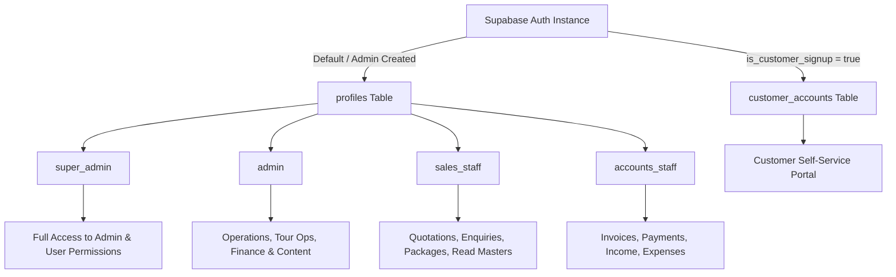
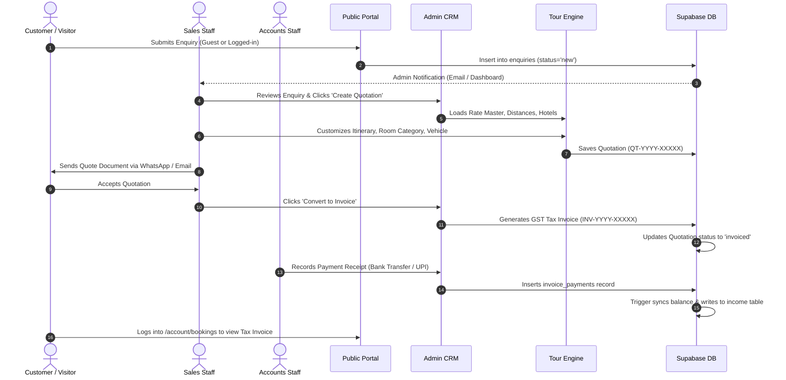
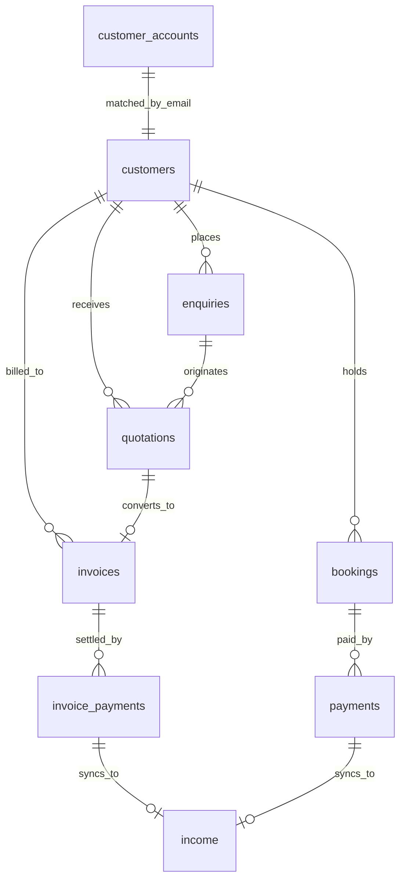
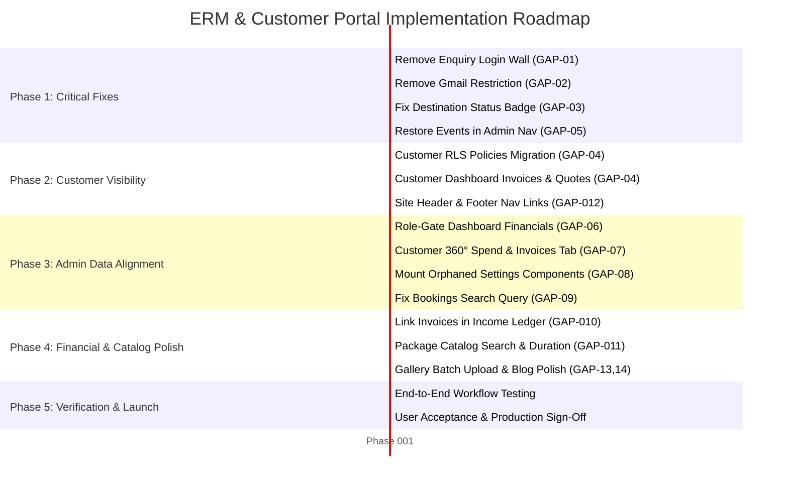

# Business Requirements Document (BRD)
## Enterprise Resource Management (ERM) & Customer Portal
### Travinco / Wayfarer Trails Travel Agency Platform

---

## 1. Document Information and Version

| Document Attribute | Specification |
| :--- | :--- |
| **Document Title** | Comprehensive Business Requirements Document (BRD) — ERM & Customer Portal |
| **Project Name** | Travinco (Wayfarer Trails) Travel Management System |
| **Document ID** | BRD-TRV-2026-V1.0 |
| **Version** | 1.0.0 (Consolidated Release Candidate) |
| **Status** | Pending Business Owner Review & Sign-Off |
| **Author / Roles** | Lead Business Analyst, Software Architect, QA Lead, UI/UX Analyst, Codebase Auditor |
| **Target Codebase** | Next.js 14.2.15 (App Router) + Supabase (PostgreSQL 15, Auth, Storage, RLS) |
| **Created Date** | October 2026 |
| **Repository Root** | `d:/Travinco` |
| **Output File** | `docs/brd/BRD.md` |

### Version History
| Version | Date | Author / Reviewer | Summary of Changes | Status |
| :--- | :--- | :--- | :--- | :--- |
| **1.0.0** | 2026-10-11 | Lead Architect / Senior BA | Initial consolidated codebase audit, current-state assessment, gap analysis, Tour Operations preservation declaration, remaining admin page specifications, customer frontend enhancement specifications, and prioritized implementation roadmap. | Awaiting Approval |

---

## 2. Executive Summary

### 2.1 Project Overview
**Travinco (Wayfarer Trails)** is a hybrid, full-stack web platform built for travel agency operations. The system comprises two interconnected environments sharing a unified PostgreSQL database managed by Supabase:
1. **Administrative Operations Portal (`/admin`)**: An internal Enterprise Resource Management (ERM), Customer Relationship Management (CRM), itinerary generation, quotation pricing, and finance management back-office.
2. **Customer-Facing Portal (`/(public)`)**: A public-facing travel catalog and discovery site providing destination overviews, packaged tour itineraries, special promotional offers, a photo gallery, travel blogs, lead/enquiry generation, and a customer self-service account area.

### 2.2 Background & Purpose of this Audit
The platform has undergone rapid iterative development. An entire specialized subsystem—**Tour Operations** (comprising Quotation Building based on a dynamic Hotel Rate Master engine, GST Tax Invoicing, Hotel Directory Management, Vehicle Transportation Pricing, Pickup/Drop Hubs, and Itinerary Day-Plan / Activity Curation)—was recently developed and finalized. 

This Business Requirements Document (BRD) provides a **rigorous, code-level architectural and business audit** of the existing application. It establishes a definitive baseline of:
- **Completed functionality to be preserved without regression** (specifically Tour Operations).
- **Remaining Admin Panel pages** that require UI, functional, database, validation, or integration enhancements.
- **Customer-Facing frontend pages** requiring workflow improvements, usability enhancements, guest conversion unlocks, and data synchronization with admin records.
- **Critical architectural fractures**, such as parallel revenue pipelines (legacy bookings vs. tour invoices), orphaned components, and restrictive customer authentication constraints.

---

## 3. Business Objectives

The business objectives driving the stabilization and completion of the Travinco ERM platform are:

1. **Protect Completed Tour Operations Investments**:
   - Ensure the advanced Quotation Engine, Rate Master database, and GST Invoicing system remain untouched, stable, and functionally central to operations.
2. **Eliminate Operational Duplication**:
   - Resolve the parallel existence of the older `bookings` pipeline and the newer `invoices` pipeline, providing staff with a coherent path from Lead/Enquiry &rarr; Quotation &rarr; Invoice & Payment &rarr; Accounting.
3. **Unlock Customer Lead Conversion**:
   - Eliminate high-friction barriers on the public frontend (such as mandatory login for submitting an initial enquiry and the restriction permitting only `@gmail.com` signups), enabling visitors from any email domain or guest status to submit trip enquiries easily.
4. **Achieve Omnichannel Customer Visibility**:
   - Allow registered customers to track their real-time trip status, view formal quotations, and review GST tax invoices generated by staff directly in their self-service dashboard (`/account/bookings`).
5. **Ensure Strict Financial Integrity & Role Governance**:
   - Enforce role-based access control (RBAC) so that operational staff (sales staff) cannot view confidential agency profit-and-loss metrics, while ensuring accounts staff have automated reconciliation between invoice payments and cashflow ledgers.
6. **Establish Release Readiness**:
   - Fix all verified code defects (e.g., broken destination status rendering, restrictive booking search parameters, orphaned navigation links) and provide an actionable, prioritized roadmap for QA and production deployment.

---

## 4. Project Scope and Exclusions

### 4.1 In-Scope (Phase Scope)
- **Codebase Audit & Gap Analysis**: Thorough examination of all frontend routes, backend Server Actions, Supabase database triggers, RLS policies, and utility functions.
- **Preservation of Tour Operations**: Documenting interfaces and dependencies of Quotations, Invoices, Hotels, Transportation, Pickup/Drop Points, Locations & Activities, and Master Data to safeguard against breaking changes.
- **Admin Panel Refinement (Outside Tour Operations)**:
  - Dashboard (`/admin`): Metrics integration and role-based widget gating.
  - Travel Packages (`/admin/packages`): Media handling, itinerary synchronization, and validation.
  - Destinations (`/admin/destinations`): Status badge bug remediation, sorting, and package count aggregation.
  - Leads & Enquiries (`/admin/enquiries`): Lead intake reconciliation and conversion action streamlining.
  - Bookings (`/admin/bookings`): Search query fixes, passenger manifest management, and alignment with Invoicing.
  - Customers (`/admin/customers`): Integration of quotations and invoices into the unified customer profile.
  - Content Management (`/admin/offers`, `/admin/events`, `/admin/gallery`, `/admin/blog`): Admin navigation restoration for Events, rich content formatting, and media management.
  - Accounting & Finance (`/admin/income`, `/admin/expenses`): Invoice reference linking, date filtering, and category management integration.
  - System Settings (`/admin/settings`): Mounting orphaned settings components (`ExpenseCategoryManager`, `FaqsSettingsForm`) and synchronizing company information with `tour_settings`.
  - Staff Management (`/admin/users`): Expanding granular module permissions to cover modern ERM modules.
- **Customer-Facing Frontend Refinement**:
  - Removal of mandatory login barriers for public enquiry submissions (`EnquiryForm`).
  - Removal of the strict `@gmail.com` validation constraint on customer signups (`signUpCustomer`).
  - Account dashboard (`/account/bookings`) upgrade to display quotations and GST invoices.
  - Navigation completeness (header and footer menu links for Events and Trip Planning).
  - Search, sorting, and filtering controls across the Package Catalog (`/packages`).

### 4.2 Out-of-Scope (Explicit Exclusions)
- **Rebuilding Tour Operations**: No redesign or code re-architecture of the quotation pricing engine (`engine.ts`), builder interface (`quotation-builder.tsx`), or invoice document (`invoice-document.tsx`).
- **Third-Party Payment Gateway Integration**: Instant online payment checkout (e.g., Razorpay / Stripe embedded checkout) is deferred; offline bank transfer, UPI manual logging, cash, and cheque reconciliation remain the current agreed scope.
- **Automated Flight/GDS Integration**: Integration with live airline booking APIs (Amadeus, Sabre) is excluded; transportation is strictly land-based vendor vehicles.
- **WhatsApp Cloud API Live BSP Onboarding**: Multi-tenant automated WhatsApp campaign blasting via Meta Cloud API BSP verification is deferred until Meta business verification is completed; WhatsApp click-to-chat links (`wa.me`) and pre-filled message templates remain the active implementation.

---

## 5. Stakeholders and User Roles

### 5.1 Project Stakeholders
- **Business Owner / Managing Director**: Primary authority on pricing markups, GST policies, banking details, and commercial terms.
- **Tour Operations Manager**: Responsible for hotel contracts, room rates, transport fleet tariffs, day plans, and quotation quality.
- **Sales & Reservation Team**: Frontline users who process enquiries, configure itinerary options, generate quotations, and follow up with guests.
- **Accounts & Finance Officer**: Manages invoice issuance, payment verification, expense categorization, and net profit auditing.
- **End Customers (Travelers)**: Prospective and confirmed guests who browse packages, submit custom trip requests, and track booking statuses.

### 5.2 User Roles & Permissions Matrix

The application employs a dual-tier authentication architecture:
1. **Staff Tier (`profiles` table)**: Authenticated internal operators governed by the `role` enum and `staff_permissions` overrides.
2. **Customer Tier (`customer_accounts` table)**: Public travelers authenticated through Supabase Auth tagged with `is_customer_signup = 'true'`.



| Functional Area | `super_admin` | `admin` | `sales_staff` | `accounts_staff` | `customer` |
| :--- | :---: | :---: | :---: | :---: | :---: |
| **System Dashboard** | Full | Full | Leads & Packages Only (No P&L) | Finance & Invoices Only | N/A |
| **Quotations** | Full + Delete | Full + Delete | Create, Edit, Send | Create, Edit, Send | View Own (Proposed) |
| **Invoices** | Full + Cancel | Full + Cancel | Issue, View | Full + Record Payments | View Own (Proposed) |
| **Hotels & Rates** | Full | Full | View Rates & Contacts | View Rates | N/A |
| **Transportation & Points** | Full | Full | View Tariffs | View | N/A |
| **Locations & Day Plans** | Full | Full | View & Use | View | N/A |
| **Rate Master Excel Import** | Full | Full | View Only | View Only | N/A |
| **Public Packages & CMS** | Full | Full | View / Edit (if granted) | View Only | View Published |
| **Leads & Enquiries** | Full | Full | Assign, Process, Follow-up | View | Submit & Track Own |
| **Legacy Bookings** | Full | Full | Manage Passengers | Record Payments | View Own |
| **Income & Expenses** | Full | Full | No Access | Full (Ledger & Categories) | N/A |
| **Settings (General & Tour)** | Full | Full | View Only | View Bank/GSTIN | View Public Contact |
| **Staff & User Access** | Full | No Access | No Access | No Access | Manage Own Profile |

---

## 6. Existing Application Architecture

### 6.1 Architectural Topology
```mermaid
graph LR
    subgraph Client Layer
        BrowserPublic[Public Web Visitor]
        BrowserCustomer[Authenticated Customer]
        BrowserAdmin[Staff / Admin Console]
    end

    subgraph Next.js 14 App Router
        MW[middleware.ts: Auth & Role Router]
        PublicPages["/(public): Packages, Blog, Enquiry, Account"]
        AdminPages["/admin: Dashboard, CRM, Finance, Settings"]
        TourOps["/admin/(tour): Quotations, Invoices, Master, Transport"]
        ServerActions[Server Actions & Route Handlers]
    end

    subgraph Service & Integration Layer
        Engine[Tour Engine: engine.ts]
        ExcelParser[Excel Rate Master Parser]
        EmailService[Gmail SMTP / Resend API]
        StorageService[Supabase Storage Buckets]
    end

    subgraph Persistence Layer (Supabase PostgreSQL)
        DB_Core[(Core: profiles, customers, enquiries)]
        DB_LegacyBookings[(Legacy: bookings, payments, passengers)]
        DB_TourOps[(Tour Ops: quotations, invoices, invoice_payments)]
        DB_RateMaster[(Rate Master: hotels, room_rates, rate_periods)]
        DB_CMS[(CMS: travel_packages, blog_posts, destinations)]
        DB_Finance[(Finance: income, expenses, categories)]
    end

    BrowserPublic --> MW --> PublicPages
    BrowserCustomer --> MW --> PublicPages
    BrowserAdmin --> MW --> AdminPages & TourOps

    PublicPages --> ServerActions
    AdminPages --> ServerActions
    TourOps --> Engine & ExcelParser & ServerActions

    ServerActions --> DB_Core & DB_LegacyBookings & DB_TourOps & DB_CMS & DB_Finance
    ServerActions --> EmailService
    ServerActions --> StorageService
```

### 6.2 Key Architectural Tenets
1. **Framework**: Next.js 14.2.15 utilizing the App Router architecture, React Server Components (RSC) for optimized data fetching, and Next.js Server Actions for mutations.
2. **Database & ORM**: PostgreSQL managed via Supabase. Direct SQL migrations (001 through 029) govern the relational schema. Queries execute through `@supabase/ssr` (cookie-authenticated SSR client) and `@supabase/supabase-js` (service-role client for background/system triggers).
3. **Database Triggers as Authority**: Critical data integrity constraints are enforced via database triggers:
   - `sync_booking_amount_received` & `recalc_booking_balance` on legacy bookings.
   - `touch_updated_at` across all relational entities.
   - `handle_new_user` decoupling staff accounts from customer signups.
4. **Tour Engine Isolation**: Pure TypeScript calculation engine (`src/lib/tour/engine.ts`) executing deterministic hotel season lookups, extra-bed pricing, vehicle mileage computation, markup calculations, and GST rounding on the server during quotation saves.
5. **Storage Architecture**: Supabase Storage buckets configured for `package-images`, `destination-images`, `gallery-images`, `blog-images`, and `site-images`.

---

## 7. Current-State Assessment

An exhaustive read-only inspection of the repository reveals the following structural, operational, and code-level findings:

### 7.1 Architecture Strengths
- **Tour Operations Excellence**: The quotation building engine, dynamic hotel pricing algorithms, room rate matrix parsing, and invoice rendering components are clean, well-tested via scripts (`scripts/test-rate-master.ts`), and feature-complete.
- **Strict Role Isolation**: `src/middleware.ts` cleanly intercepts customer attempts to access `/admin/**` and enforces authenticated cookie validation.
- **Robust Schema Migrations**: 30 distinct SQL migration files with referential constraints, sequence generators (`QT-YYYY-XXXXX`, `INV-YYYY-XXXXX`), check constraints, and indexes.

### 7.2 Critical Deficiencies & Architectural Fractures
1. **Parallel Revenue Pipelines**:
   - The application has two distinct booking flows:
     - **Flow A (Legacy)**: Enquiries &rarr; Convert to Booking &rarr; `bookings` table (`BK-`) &rarr; `payments` table.
     - **Flow B (Tour Operations)**: Enquiries &rarr; Create Quotation &rarr; `quotations` table (`QT-`) &rarr; Convert to Invoice &rarr; `invoices` table (`INV-`) &rarr; `invoice_payments` table &rarr; `income` table.
   - These flows operate in silos. The Customer Account dashboard only inspects Flow A, leaving invoices and quotations invisible to customers.
2. **Artificial Lead Conversion Barriers**:
   - `src/components/public/enquiry-form.tsx` (lines 50–68) explicitly blocks non-logged-in users from sending trip enquiries.
   - `src/app/(public)/account/actions.ts` (lines 13–15) enforces that customer signup emails MUST end with `@gmail.com`, preventing all corporate, Yahoo, Outlook, or custom-domain users from registering.
3. **Data Display Bugs in Admin Panel**:
   - In `src/app/admin/destinations/page.tsx` (line 77), the UI checks `d.is_active ? 'active' : 'inactive'`. However, the `destinations` table has no `is_active` column—it uses `status content_status`. As a result, `d.is_active` evaluates to `undefined`, causing **every destination to display as "Inactive"** regardless of its real state.
   - In `src/app/admin/bookings/page.tsx` (line 84), the search input filters solely on `booking_number.ilike.%q%`. Admins typing customer names or phone numbers get zero results.
4. **Orphaned Admin Modules & Components**:
   - `src/app/admin/events/`: The Events admin page is fully implemented with CRUD and database linkage, but was omitted from `src/lib/admin-nav.ts`. Admins cannot access it without guessing the URL.
   - `src/app/admin/settings/expense-category-manager.tsx`: Developed component for managing expense categories, but never imported or rendered in `src/app/admin/settings/page.tsx`.
   - `src/app/admin/settings/faqs-settings-form.tsx`: Developed component for managing site-wide package FAQs, but never rendered in `src/app/admin/settings/page.tsx`.
5. **Missing Documented Features**:
   - WhatsApp broadcast campaign controllers (`/admin/whatsapp`) and financial charts (`/admin/reports`) referenced in early project documentation (`README.md`, `WORKFLOW_EXPLANATION.txt`) do not exist in the codebase.
6. **Customer Spend Metric Omission**:
   - In `src/app/admin/customers/[id]/page.tsx`, "Total Spend" and "Booking Value" are calculated exclusively by querying legacy `bookings`, ignoring all invoices generated under Tour Operations.

---

## 8. Completed Tour Operations Modules

> [!IMPORTANT]
> **Preservation Directive**: All modules under the **Tour Operations** section are deemed fully completed and production-grade. They must be preserved intact. No redesigns or structural rewrites are permitted.

### 8.1 Inventory of Completed Tour Operations Scope

| Sub-Module | Primary Route | Key File Implementations | Operational Functionality |
| :--- | :--- | :--- | :--- |
| **Quotations** | `/admin/quotations`<br>`/admin/quotations/[id]`<br>`/admin/quotations/new` | `src/app/admin/quotations/**`<br>`src/components/tour/quotation-builder.tsx`<br>`src/components/tour/quote-document.tsx`<br>`src/lib/tour/engine.ts` | Multi-option itinerary builder; dynamic Rate Master hotel pricing by season; meal plan toggling (CP/MAP); vehicle mileage calculator; markup & GST computation; WhatsApp text export; print stylesheet. |
| **Invoices** | `/admin/invoices`<br>`/admin/invoices/[id]` | `src/app/admin/invoices/**`<br>`src/components/tour/invoice-document.tsx`<br>`src/app/admin/invoices/[id]/invoice-client.tsx` | GST Tax Invoice generation; CGST/SGST vs IGST split; payment tracking (`invoice_payments`); balance reconciliation; automated income ledger sync; printable tax invoice format. |
| **Hotels** | `/admin/hotels`<br>`/admin/hotels/[id]`<br>`/admin/hotels/new` | `src/app/admin/hotels/**`<br>`src/app/admin/hotels/hotel-form.tsx`<br>`src/app/admin/hotels/followups.tsx` | Hotel directory management; operational contacts (reservation email, phone, WhatsApp); category assignment; seasonal room rate matrix; follow-up logging. |
| **Transportation** | `/admin/transport` | `src/app/admin/transport/page.tsx`<br>`src/components/admin/entity-manager.tsx` | Transport operator and vehicle catalog; per-day vs per-trip rate basis; free km thresholds; extra ₹/km charges; driver bata allowances. |
| **Pickup & Drop Points** | `/admin/pickup-points` | `src/app/admin/pickup-points/page.tsx`<br>`src/components/admin/entity-manager.tsx` | Airport, railway, bus, and port terminal hub management; distance-to-town (km) offsets used in vehicle routing calculations. |
| **Locations & Activities** | `/admin/locations` | `src/app/admin/locations/**`<br>`src/app/admin/locations/tabs.tsx`<br>`src/app/admin/locations/layout.tsx` | Four-tier operational catalog: 1. Main town locations; 2. Sightseeing & activities directory; 3. Inter-location road distance matrix; 4. Pre-built day plan variants. |
| **Master Data (Rate Master)** | `/admin/master` | `src/app/admin/master/**`<br>`src/lib/excel/master-parser.ts`<br>`src/lib/services/master-rates-db.ts` | Excel spreadsheet upload (`.xlsx`/`.xls`) parsing hotel rate master matrices; seasonal date window extraction; automated database population. |
| **Tour Settings** | `/admin/quotations/settings` | `src/app/admin/quotations/settings/**`<br>`src/lib/tour/master-actions.ts` | Operational rules: default markup % (15%), GST % (5%), rounding unit (₹100), company GSTIN, bank details, standard inclusions/exclusions, cancellation policies. |

### 8.2 Tour Operations Preservation Safeguards
- Any modifications to shared tables (e.g., `customers`, `enquiries`, `income`, `profiles`) must ensure non-breaking backwards compatibility with `029_tour_operations.sql` views and foreign keys.
- The PostgreSQL view `v_quote_rates` and table sequences `quotation_number_seq` and `invoice_number_seq` must never be dropped or structurally altered.

---

## 9. Admin Panel — Remaining Pages and Required Modifications

This section documents every Admin Panel page outside the Tour Operations section, providing concrete evidence of existing behavior, identified problems, and required changes.

### 9.1 Admin Dashboard (`/admin`)
- **Existing Behaviour**: Displays lead status cards (Fresh Lead, Follow Up, Interested, Enquired), monthly income and expense metrics, top-selling packages (ranked by bookings count), and a table of the 6 most recent enquiries.
- **Problems Identified**:
  1. *Omission of Tour Operations*: Dashboard metrics calculate revenue exclusively from `bookings`. High-value invoices and quotations created in Tour Operations are completely ignored.
  2. *Confidential Data Exposure*: Financial overview cards (Total Income, Total Expenses, Net Profit) render for all logged-in staff. Sales staff can view confidential agency net profit figures.
  3. *Static Date Filtering*: Hardcoded to the current calendar month without ability to view historical months, quarters, or custom ranges.
- **Required Changes**:
  - Gated financial cards: Wrap monthly financial summary widgets in a role assertion check (`['accounts_staff', 'admin', 'super_admin'].includes(profile.role)`).
  - Tour Operations KPI cards: Add counts for Active Quotations (`quotations` where status = `'sent'`) and Pending Invoices (`invoices` where status in `('issued', 'partially_paid')`).
  - Unified Revenue metric: Aggregate income receipts from both legacy bookings and invoice payments.
- **Acceptance Criteria**:
  - Sales staff logging into `/admin` do NOT see Income, Expense, or Net Profit cards.
  - Quotation and Invoice status counts accurately reflect database records.
- **Dependencies**: Server Component refactor in [src/app/admin/page.tsx](file:///d:/Travinco/src/app/admin/page.tsx).

---

### 9.2 Packages Management (`/admin/packages`, `/admin/packages/new`, `/admin/packages/[id]`)
- **Existing Behaviour**: Provides full CRUD for public holiday packages, including cover/tile image uploads, day-by-day itineraries, inclusions/exclusions, FAQ managers, and preview capabilities.
- **Problems Identified**:
  1. *Disconnect from Tour Templates*: Tour Operations maintains `quotation_templates` (11 pre-seeded tour packages with verified hotel category linkages and day plans), while `travel_packages` is a separate table. Staff must re-enter package data twice.
  2. *Limited Filter Controls*: Admin list page only supports keyword search on title and status filtering. Filtering by Destination, Duration, or Category is absent.
- **Required Changes**:
  - Add "Import from Quotation Template" action in package creator, allowing staff to prepopulate public package itineraries from pre-built Tour Operations templates.
  - Add Destination and Category filter dropdowns to the package list table header.
  - Implement bulk status toggle (Publish / Unpublish selected packages).
- **Acceptance Criteria**:
  - Selecting a quotation template auto-populates package itinerary days, duration, and title.
  - Destination filter correctly limits package table rows via URL search parameters.
- **Dependencies**: `travel_packages` & `quotation_templates` join in [src/app/admin/packages/actions.ts](file:///d:/Travinco/src/app/admin/packages/actions.ts).

---

### 9.3 Destinations Management (`/admin/destinations`, `/admin/destinations/new`, `/admin/destinations/[id]`)
- **Existing Behaviour**: CRUD table listing destinations, country, featured status, cover image, and sort order.
- **Problems Identified**:
  1. *Critical Status Badge Bug*: [src/app/admin/destinations/page.tsx:77](file:///d:/Travinco/src/app/admin/destinations/page.tsx#L77) checks `d.is_active ? 'active' : 'inactive'`. The database column is `status` (`content_status` enum: `'draft' | 'published' | 'archived'`). Because `d.is_active` is undefined, **all destinations display as "Inactive"** in the UI.
  2. *Missing Package Count Summary*: Destination list does not show how many active packages are linked to each destination.
  3. *Sort Order Controls*: Sorting requires manual numeric editing inside each destination edit page; no table drag-and-drop or quick sort exists.
- **Required Changes**:
  - Fix status badge: Update line 77 to `<StatusBadge status={d.status} />`.
  - Add Package Count column: Join `travel_packages(count)` in Supabase query to display total active packages per destination.
  - Quick publish/draft toggle directly in row actions.
- **Acceptance Criteria**:
  - Published destinations display green "Published" badge.
  - Package count reflects exact database count of linked `travel_packages`.
- **Dependencies**: [src/app/admin/destinations/page.tsx](file:///d:/Travinco/src/app/admin/destinations/page.tsx).

---

### 9.4 Leads & Enquiries CRM (`/admin/enquiries`, `/admin/enquiries/[id]`)
- **Existing Behaviour**: Comprehensive lead CRM tracking status (`new`, `contacted`, `follow_up`, `quotation_sent`, `negotiation`, `confirmed`, `lost`, `closed`), assigned staff, traveler counts, internal notes, follow-up reminders, and activity audit timeline.
- **Problems Identified**:
  1. *Confusing Dual Conversion Buttons*: [src/app/admin/enquiries/[id]/page.tsx](file:///d:/Travinco/src/app/admin/enquiries/[id]/page.tsx) displays both "Create quotation" (links to `/admin/quotations/new`) and "Convert to booking" (creates legacy `bookings` record). Staff have no guidance on which pipeline to follow.
  2. *Unlinked Customer Records*: Inbound public enquiries created via `submitEnquiry` do not automatically link to existing `customers` records matching the same phone or email.
- **Required Changes**:
  - Conversion workflow unification: Designate "Create quotation" as the primary recommended action for customized tours, and re-label "Convert to booking" as "Quick Direct Booking (Fixed Package)" with an explanatory tooltip.
  - Auto-link Customer: On enquiry arrival, check `customers` by phone/email; if matched, populate `enquiries.customer_id`. If not matched, auto-create customer record upon enquiry assignment or quote creation.
- **Acceptance Criteria**:
  - Inbound enquiry with matching existing customer phone automatically associates `customer_id`.
  - Clear visual distinction between Quotation flow and Direct Fixed Booking flow.
- **Dependencies**: [src/app/admin/enquiries/actions.ts](file:///d:/Travinco/src/app/admin/enquiries/actions.ts).

---

### 9.5 Legacy Bookings (`/admin/bookings`, `/admin/bookings/[id]`)
- **Existing Behaviour**: List of confirmed package bookings (`BK-` sequence), passenger manifest manager, payment recording against booking, and automatic balance recalculation via triggers.
- **Problems Identified**:
  1. *Defective Search Filter*: [src/app/admin/bookings/page.tsx:84](file:///d:/Travinco/src/app/admin/bookings/page.tsx#L84) uses `query = query.or(\`booking_number.ilike.%${searchParams.q}%\`)`. Searching for a traveler's name returns zero results.
  2. *Duplicate Payment Entry Risk*: When an enquiry is converted to both an Invoice and a Booking, payments could be recorded twice.
- **Required Changes**:
  - Expand search query: Enable search across `booking_number`, customer name, and customer phone using Supabase foreign table joins or customer IDs lookup.
  - Cross-link Invoice: If a booking has a corresponding Tour Operations invoice, display a prominent banner linking to `/admin/invoices/[id]`.
- **Acceptance Criteria**:
  - Typing a customer's surname into search input returns their booking records.
  - Linked invoice badge displays when `quotation_id` or invoice exists for the trip.
- **Dependencies**: [src/app/admin/bookings/page.tsx](file:///d:/Travinco/src/app/admin/bookings/page.tsx).

---

### 9.6 Customers Directory (`/admin/customers`, `/admin/customers/[id]`, `/admin/customers/new`)
- **Existing Behaviour**: Master CRM contact record displaying customer contact info, tags, source, notes, WhatsApp opt-in status, linked enquiries, and linked bookings.
- **Problems Identified**:
  1. *Omission of Tour Operations Data*: [src/app/admin/customers/[id]/page.tsx](file:///d:/Travinco/src/app/admin/customers/[id]/page.tsx) queries ONLY `enquiries` and `bookings`. All `quotations` and `invoices` generated for that customer in Tour Operations are completely missing from the customer's detail view!
  2. *Inaccurate Total Spend*: Total spend is calculated solely from `bookings.amount_received`, omitting all invoice payments.
- **Required Changes**:
  - Customer Profile Query Upgrade: Fetch linked `quotations` (`where customer_id = params.id`) and `invoices` (`where customer_id = params.id`).
  - Add "Quotations" and "Invoices" tabs/panels to customer profile.
  - Update Total Spend metric: Aggregate `bookings.amount_received` + `invoices.amount_paid`.
- **Acceptance Criteria**:
  - Customer profile lists all quotations and tax invoices issued to the customer.
  - Total Spend includes invoice payments.
- **Dependencies**: [src/app/admin/customers/[id]/page.tsx](file:///d:/Travinco/src/app/admin/customers/[id]/page.tsx).

---

### 9.7 Special Offers (`/admin/offers`, `/admin/offers/new`, `/admin/offers/[id]`)
- **Existing Behaviour**: Promotional campaign creator linking discounts (percentage or flat ₹) to specific packages within date windows (`valid_from` to `valid_to`).
- **Problems Identified**:
  - Image upload missing: Form accepts only package selection and title/dates; image upload helper is not mounted in the form, limiting visual promotional banners.
- **Required Changes**:
  - Add banner image upload using Supabase Storage bucket (`site-images`).
  - Add active/expired filter status toggle on the list table.
- **Acceptance Criteria**:
  - Uploaded offer banner renders in list view and on public homepage banner.
- **Dependencies**: [src/app/admin/offers/offer-form.tsx](file:///d:/Travinco/src/app/admin/offers/offer-form.tsx).

---

### 9.8 Events Management (`/admin/events`, `/admin/events/new`, `/admin/events/[id]`)
- **Existing Behaviour**: Complete CRUD page and database persistence for travel events, dates, locations, CTA links, and cover photos.
- **Problems Identified**:
  1. *Orphaned Route*: Route `/admin/events` is **missing from `src/lib/admin-nav.ts`**. Admins cannot navigate to this page from the sidebar menu.
- **Required Changes**:
  - Add Events item to `src/lib/admin-nav.ts`:
    ```typescript
    { label: 'Events', href: '/admin/events', icon: 'Calendar', module: 'offers' }
    ```
- **Acceptance Criteria**:
  - "Events" appears in the Admin sidebar navigation for authorized roles.
- **Dependencies**: [src/lib/admin-nav.ts](file:///d:/Travinco/src/lib/admin-nav.ts).

---

### 9.9 Gallery Management (`/admin/gallery`)
- **Existing Behaviour**: Hierarchical country and place/category folder structure, image upload to Supabase storage, folder rename/delete, status toggling.
- **Problems Identified**:
  - Bulk image upload missing: Staff can only upload one image at a time via `GalleryAddForm`.
- **Required Changes**:
  - Enable multi-file selection (`<input type="file" multiple />`) and batch progress uploading in `gallery-add-form.tsx`.
- **Acceptance Criteria**:
  - Staff can select 10 images at once and batch-upload them into a selected country/place folder.
- **Dependencies**: [src/app/admin/gallery/gallery-add-form.tsx](file:///d:/Travinco/src/app/admin/gallery/gallery-add-form.tsx).

---

### 9.10 Blog CMS (`/admin/blog`, `/admin/blog/new`, `/admin/blog/[id]`)
- **Existing Behaviour**: Basic post manager: title, slug, excerpt, cover photo upload, and plain textarea content.
- **Problems Identified**:
  1. *No Formatting Controls*: Plain textarea requires manual blank lines for paragraphs. No support for markdown headings, bold, bullet points, or travel itinerary tips.
  2. *Missing Metadata*: No category/tag assignment or author selection.
- **Required Changes**:
  - Add Markdown formatting toolbar or rich-text preview.
  - Add Author attribution dropdown (selecting from active staff `profiles`).
  - Add Category / Tag tag-cloud input.
- **Acceptance Criteria**:
  - Formatting (bold, lists, headings) renders correctly on public `/blog/[slug]`.
- **Dependencies**: [src/app/admin/blog/blog-post-form.tsx](file:///d:/Travinco/src/app/admin/blog/blog-post-form.tsx).

---

### 9.11 Financial Accounting (`/admin/income`, `/admin/expenses`)
- **Existing Behaviour**: Two ledger tables recording income receipts and expense vouchers with pagination and quick-add dialogs.
- **Problems Identified**:
  1. *Missing Invoice Linkage in Income*: [src/app/admin/income/page.tsx:68-80](file:///d:/Travinco/src/app/admin/income/page.tsx#L68-L80) renders customer name and booking number. When income originates from an Invoice payment (`invoice_id is not null`), the invoice number is not displayed or linked.
  2. *No Date Range Filtering*: Neither Income nor Expenses allows staff to filter transactions between two dates or by quarter.
  3. *No Category Filter on Expenses*: Staff cannot filter expenses by category (e.g., "Hotel", "Fuel").
- **Required Changes**:
  - Update `income/page.tsx` query to join `invoices(invoice_number)` and render clickable link `INV-XXXXX`.
  - Add Date Range Filter bar (Start Date & End Date pickers) to both Income and Expense tables.
  - Add Category dropdown filter on Expenses.
  - Add Export to Excel / CSV button for reconciliation.
- **Acceptance Criteria**:
  - Payments recorded against Tour Operations invoices display their invoice reference in the Income ledger.
  - Date filtering correctly scopes total displayed amounts.
- **Dependencies**: [src/app/admin/income/page.tsx](file:///d:/Travinco/src/app/admin/income/page.tsx) & [src/app/admin/expenses/page.tsx](file:///d:/Travinco/src/app/admin/expenses/page.tsx).

---

### 9.12 Settings Management (`/admin/settings`)
- **Existing Behaviour**: Form managing Agency General Settings (business name, phone, WhatsApp, email, address, working hours, map embed), Booking defaults, and Terms & Conditions.
- **Problems Identified**:
  1. *Orphaned Components*: `ExpenseCategoryManager` (`expense-category-manager.tsx`) and `FaqsSettingsForm` (`faqs-settings-form.tsx`) exist in the directory but are **not rendered on `/admin/settings/page.tsx`**.
  2. *Duplicate Company Information*: Agency contact info is split between `website_settings` (`/admin/settings`) and `tour_settings` (`/admin/quotations/settings`). Updating phone/address in Settings does not update Invoices or Quotations.
- **Required Changes**:
  - Mount `ExpenseCategoryManager` and `FaqsSettingsForm` on `/admin/settings/page.tsx`.
  - Synchronize or cross-reference `tour_settings` company metadata (GSTIN, bank details, legal address) so settings remain uniform.
- **Acceptance Criteria**:
  - Admins can add and activate expense categories directly from `/admin/settings`.
  - Site-wide FAQs can be edited and automatically appear across all public package pages.
- **Dependencies**: [src/app/admin/settings/page.tsx](file:///d:/Travinco/src/app/admin/settings/page.tsx).

---

### 9.13 Staff & Permissions (`/admin/users`, `/admin/users/[id]`)
- **Existing Behaviour**: Super Admin user table managing staff roles (`super_admin`, `admin`, `sales_staff`, `accounts_staff`), active status, and granular per-module permission checkboxes.
- **Problems Identified**:
  1. *Outdated Permission Matrix*: The 8 configurable modules in `user-permissions-form.tsx` (`packages`, `destinations`, `enquiries`, `offers`, `gallery`, `blog`, `settings`, `users`) omit all Tour Operations modules and Finance modules. Staff permissions for Quotations, Invoices, Hotels, Transportation, and Income/Expenses cannot be customized per user.
- **Required Changes**:
  - Expand `MODULES` array in `user-permissions-form.tsx` to include `quotations`, `invoices`, `hotels`, `transport`, `locations`, `finance`.
  - Update `023_staff_permissions.sql` check constraint to support the new module identifiers.
- **Acceptance Criteria**:
  - Super admin can grant a sales staff member view-only or edit permissions to Hotels or Invoices.
- **Dependencies**: [src/app/admin/users/[id]/user-permissions-form.tsx](file:///d:/Travinco/src/app/admin/users/[id]/user-permissions-form.tsx).

---

## 10. Customer-Facing Frontend — Required Modifications

This section documents required modifications across customer-facing pages, identifying barriers to booking conversion, navigation gaps, and data synchronization requirements.

### 10.1 Public Homepage (`/`)
- **Existing Behaviour**: Responsive landing page featuring hero collage, search bar, narrative overview, package cards, destination grid, testimonials carousel, and newsletter/contact banner.
- **Problems Identified**:
  1. *Static Testimonials*: Reviews are pulled from static TypeScript file (`src/lib/testimonials-data.ts`) rather than manageable via the database.
  2. *Search Redirect*: Hero search dropdown redirects to `/packages?destination=[slug]`, but the Packages page does not pre-select the search bar or support keyword search.
- **Required Changes**:
  - Enhance hero search bar to support both destination dropdown and free-text destination search.
  - Wire dynamic featured testimonials or provide an admin configuration point.
- **Acceptance Criteria**:
  - Searching "Munnar" in hero input routes visitor to `/packages?q=Munnar` with matching results displayed.
- **Dependencies**: [src/app/(public)/page.tsx](file:///d:/Travinco/src/app/(public)/page.tsx).

---

### 10.2 Package Catalog (`/packages`)
- **Existing Behaviour**: Grid of published packages with destination and category dropdown filters.
- **Problems Identified**:
  1. *Missing Search & Range Filters*: Visitors cannot filter packages by duration (e.g., 3–5 Days, 6–8 Days), budget price range, or search keywords.
  2. *In-Memory Filtering*: Destination filter executes in memory on the server (`packages.filter(...)`) rather than using SQL queries.
- **Required Changes**:
  - Add text search input for package title and highlights.
  - Add Duration filter (`1-3 Days`, `4-7 Days`, `8+ Days`).
  - Move destination filtering into Supabase query `.eq('destination_id', ...)` for query efficiency.
  - Add sorting options: "Price: Low to High", "Price: High to Low", "Duration: Short to Long".
- **Acceptance Criteria**:
  - Filtering by duration or price updates URL search parameters and returns matching packages.
- **Dependencies**: [src/app/(public)/packages/page.tsx](file:///d:/Travinco/src/app/(public)/packages/page.tsx).

---

### 10.3 Package Detail Page (`/packages/[slug]`)
- **Existing Behaviour**: Detailed presentation including overview, day-by-day itinerary, inclusions, exclusions, gallery lightbox, video embeds, FAQs, pricing, WhatsApp/call links, and enquiry form.
- **Problems Identified**:
  1. *MANDATORY LOGIN BLOCKER*: [src/components/public/enquiry-form.tsx:50-68](file:///d:/Travinco/src/components/public/enquiry-form.tsx#L50-L68) checks `if (!isLoggedIn)`. If visitor is not logged in, the form is replaced by: *"Please log in to send a request. You'll need an account to submit a booking or enquiry..."* This severely impairs lead capture and user conversion.
  2. *Dynamic Pricing Tiers*: Displays only `base_price` and `discount_price`. Does not break down Child or Infant pricing even though columns exist in database.
- **Required Changes**:
  - **CRITICAL**: Remove mandatory login wall from `EnquiryForm`. Allow any guest visitor to submit an enquiry by providing Name, Email, and Phone number.
  - Add Guest Account Auto-Creation / Claim: If visitor is not logged in, submission succeeds, creates the lead, and provides an optional link to set a password to track the enquiry.
  - Display Child and Infant pricing policies when configured on the package.
- **Acceptance Criteria**:
  - Unauthenticated visitor can fill out Name, Phone, and Travel Dates and successfully submit the enquiry, receiving an enquiry reference number (`ENQ-XXXXX`).
  - Enquiry record appears immediately in Admin CRM (`/admin/enquiries`).
- **Dependencies**: [src/components/public/enquiry-form.tsx](file:///d:/Travinco/src/components/public/enquiry-form.tsx), [src/app/(public)/actions.ts](file:///d:/Travinco/src/app/(public)/actions.ts).

---

### 10.4 Standalone Trip Planning Page (`/booking`)
- **Existing Behaviour**: Standalone trip planning page ("Plan Your Trip") designed for custom itinerary requests.
- **Problems Identified**:
  1. *Mandatory Login Barrier*: Renders the same `EnquiryForm` with `isLoggedIn={Boolean(user)}`. Unauthenticated travelers cannot request custom itineraries.
  2. *Navigation Invisibility*: `/booking` is not included in the main site header navigation.
- **Required Changes**:
  - Enable guest submissions without login.
  - Add "Plan a Trip" CTA button in `SiteHeader` desktop and mobile menus.
- **Acceptance Criteria**:
  - Guest visitor can request a custom itinerary from `/booking`.
- **Dependencies**: [src/app/(public)/booking/page.tsx](file:///d:/Travinco/src/app/(public)/booking/page.tsx), [src/components/public/site-header.tsx](file:///d:/Travinco/src/components/public/site-header.tsx).

---

### 10.5 Customer Authentication & Signup (`/account/signup`, `/account/login`)
- **Existing Behaviour**: Customer account creation and login decoupled from staff profiles.
- **Problems Identified**:
  1. *ARBITRARY @GMAIL.COM RESTRICTION*: [src/app/(public)/account/signup/page.tsx:35](file:///d:/Travinco/src/app/(public)/account/signup/page.tsx#L35) and [src/app/(public)/account/actions.ts:13-15](file:///d:/Travinco/src/app/(public)/account/actions.ts#L13-L15) reject any email not ending with `@gmail.com`. Users with Outlook, Yahoo, Apple iCloud, or corporate domains cannot create accounts.
  2. *Excessive Password Complexity*: Requires uppercase, lowercase, number, symbol, and 7+ chars. Valid, but error messaging can be frustrating for mobile travelers.
- **Required Changes**:
  - **CRITICAL**: Remove the `.endsWith('@gmail.com')` refinement from `signupSchema` in `account/actions.ts` and remove the client-side restriction in `account/signup/page.tsx`. Allow all RFC-compliant email domains.
  - Retain sensible password rules (min 8 characters).
- **Acceptance Criteria**:
  - A user with `user@outlook.com` or `traveler@company.in` can successfully sign up and log in.
- **Dependencies**: [src/app/(public)/account/actions.ts](file:///d:/Travinco/src/app/(public)/account/actions.ts), [src/app/(public)/account/signup/page.tsx](file:///d:/Travinco/src/app/(public)/account/signup/page.tsx).

---

### 10.6 Customer Bookings & Self-Service (`/account/bookings`)
- **Existing Behaviour**: Authenticated customer dashboard showing past trip enquiries and legacy bookings matched by email.
- **Problems Identified**:
  1. *Tour Operations Invisibility*: Queries only `bookings` and `enquiries`. Quotations and Invoices created via Tour Operations never appear for the customer.
  2. *RLS Security Policy Block*: In migration `029_tour_operations.sql`, RLS policies on `quotations` and `invoices` permit SELECT exclusively to `public.is_staff()`. Customers have no database permission to view their own quotations or invoices.
  3. *No Document Download*: Customer cannot view or download their formal quotation itinerary or tax invoice PDF.
- **Required Changes**:
  - Add RLS policies permitting authenticated customers to SELECT quotations and invoices where `customer_id` matches their verified customer record:
    ```sql
    CREATE POLICY "customers read own quotations" ON quotations
      FOR SELECT USING (
        EXISTS (
          SELECT 1 FROM customers c
          JOIN customer_accounts ca ON ca.email = c.email
          WHERE c.id = quotations.customer_id AND ca.id = auth.uid()
        )
      );
    CREATE POLICY "customers read own invoices" ON invoices
      FOR SELECT USING (
        EXISTS (
          SELECT 1 FROM customers c
          JOIN customer_accounts ca ON ca.email = c.email
          WHERE c.id = invoices.customer_id AND ca.id = auth.uid()
        )
      );
    ```
  - Update `/account/bookings/page.tsx` to fetch and render customer Quotations and Invoices alongside Bookings.
  - Provide a clean "View Quotation" and "View Invoice" modal / printable view.
- **Acceptance Criteria**:
  - Customer logged in with `john@example.com` can view all quotations and GST invoices issued to their email.
  - Balance amount and payment status are clearly displayed.
- **Dependencies**: SQL Migration, [src/app/(public)/account/bookings/page.tsx](file:///d:/Travinco/src/app/(public)/account/bookings/page.tsx).

---

### 10.7 Site Navigation (`SiteHeader`, `SiteFooter`)
- **Existing Behaviour**: Responsive header with desktop dropdown for destinations, language picker (EN, HI, ML), and mobile sliding drawer.
- **Problems Identified**:
  1. *Missing Links*: "Events" (`/events`) is completely missing from both Header and Footer. "Plan a Trip" (`/booking`) is missing from the Header.
- **Required Changes**:
  - Add "Events" to `navLinks` in `SiteHeader` and Explore list in `SiteFooter`.
  - Add prominent "Plan a Trip" action button in `SiteHeader`.
- **Acceptance Criteria**:
  - Header displays Home, Packages, Destinations, Offers, Events, Gallery, Blog, About, Contact, and Plan a Trip CTA.
- **Dependencies**: [src/components/public/site-header.tsx](file:///d:/Travinco/src/components/public/site-header.tsx), [src/components/public/site-footer.tsx](file:///d:/Travinco/src/components/public/site-footer.tsx).

---

## 11. Functional Requirements

### 11.1 Lead & CRM Lifecycle Requirements
- **FR-CRM-01**: Inbound trip enquiries must accept guest submissions (without authentication) and store customer name, phone, WhatsApp number, email, travel dates, passenger counts, budget, and custom message in `enquiries`.
- **FR-CRM-02**: Enquiries must be automatically matched against `customers` by phone or email. If matched, `enquiry.customer_id` must be populated immediately.
- **FR-CRM-03**: Sales staff must be able to schedule follow-ups (date, time, type: call/WhatsApp/email/meeting) and record activity logs on each lead.
- **FR-CRM-04**: Staff must be able to transition enquiries from `'new'` to `'contacted'`, `'quotation_sent'`, `'negotiation'`, `'confirmed'`, `'lost'`, or `'closed'`.

### 11.2 Tour Operations & Pricing Requirements (Preserved Core)
- **FR-TOP-01**: Staff must be able to generate multi-option custom quotations (`QT-`) by selecting travel dates, room counts, passenger counts, pickup/drop hubs, and hotel categories.
- **FR-TOP-02**: Hotel rates must be looked up dynamically from `v_quote_rates` based on date overlap and season priority.
- **FR-TOP-03**: Vehicle transportation charges must be calculated dynamically based on route distances, extra km rates, and driver bata.
- **FR-TOP-04**: Total quotation pricing must incorporate configured markup percentage (default 15%), GST percentage (default 5%), and rounding (to ₹100).
- **FR-TOP-05**: Converting an accepted quotation to an invoice must generate a formal GST tax invoice (`INV-`), back-calculating taxable value from package total, applying CGST+SGST or IGST depending on place of supply.
- **FR-TOP-06**: Invoice payments recorded by accounts staff must update invoice balance and automatically book a matching transaction in the `income` table.

### 11.3 Catalog & Content Management Requirements
- **FR-CMS-01**: Admins must be able to publish travel packages with cover images, itineraries, inclusions, exclusions, and FAQs.
- **FR-CMS-02**: Admins must be able to manage destinations with cover photos and slug generation. Destination status must accurately reflect published/draft status in the admin UI.
- **FR-CMS-03**: Promotional offers must link to specific packages and discount rates, automatically reverting to standard pricing once expiration dates pass.
- **FR-CMS-04**: Travel events must be manageable in the admin portal and discoverable through public navigation.
- **FR-CMS-05**: Photo gallery must support hierarchical categorization (Country & Place) and direct storage uploads.

### 11.4 Customer Self-Service & Account Requirements
- **FR-CST-01**: Customers must be able to register accounts using any valid email domain (removing the `@gmail.com` restriction).
- **FR-CST-02**: Customers must be able to log in, reset passwords, and view their personal travel dashboard (`/account/bookings`).
- **FR-CST-03**: The customer dashboard must display all confirmed bookings, issued quotations, and GST invoices associated with the customer's email.
- **FR-CST-04**: Customers must be able to view and print their formal quotation itinerary and GST tax invoice.

---

## 12. Business Rules and Workflows

### 12.1 End-to-End Quotation-to-Invoice Workflow


### 12.2 Critical Business Rules
1. **BR-FIN-01 (GST Determination)**:
   - If the supply takes place within Kerala (company registered state), GST is split into **CGST (2.5%) + SGST (2.5%)**.
   - If the supply place is outside Kerala, GST is booked as **IGST (5.0%)**.
2. **BR-FIN-02 (Gross Package Invoicing)**:
   - When converting a Quotation to an Invoice, the guest pays the exact quoted package price. The taxable amount is back-calculated:
     $$\text{Taxable Amount} = \frac{\text{Quotation Total}}{1 + (\text{GST \%} / 100)}$$
3. **BR-SEC-01 (Dual-Tier Auth Isolation)**:
   - Customer accounts must never be granted `profiles` records or admin CRM permissions. Any signup flagged with `is_customer_signup = 'true'` creates a `customer_accounts` record and is blocked from `/admin/**`.
4. **BR-LEAD-01 (Lead Intake Freedom)**:
   - Inbound lead generation on public package pages must never require mandatory authentication. Guest enquiries must always be accepted to maximize business conversion.

---

## 13. Non-Functional Requirements

### 13.1 Performance & Responsiveness
- **NFR-PERF-01**: Admin dashboard initial paint must load within 800ms utilizing server component streaming and Suspense skeletons.
- **NFR-PERF-02**: Tour quotation calculation engine must compute hotel season matrix and vehicle tariffs in less than 50ms per quotation build.
- **NFR-PERF-03**: All customer-facing pages must score 90+ on Google Lighthouse Mobile Performance.

### 13.2 Security & Data Privacy
- **NFR-SEC-01**: All database tables must have Supabase Row Level Security (RLS) enabled. Public access is restricted to SELECT on published content and INSERT on enquiries.
- **NFR-SEC-02**: Privileged service role operations (`SUPABASE_SERVICE_ROLE_KEY`) must never be bundled into client-side code; restricted exclusively to server-side tasks.
- **NFR-SEC-03**: Anti-abuse rate limiting must prevent submission spamming (max 3 enquiry submissions per IP per 10-minute window).

### 13.3 Reliability & Browser Compatibility
- **NFR-REL-01**: Print stylesheets for Quotations and Tax Invoices must format cleanly on standard A4 paper without pagination clipping across Chrome, Safari, and Edge.
- **NFR-REL-02**: The application must be fully responsive across mobile (375px+), tablet (768px+), and desktop (1024px+) viewports.

---

## 14. Consolidated Gap Analysis

The following consolidated gap-analysis table categorizes all audited pages and modules, defining existing implementation status, identified defects, proposed modifications, priorities, and acceptance criteria.

### Priority Legend
- **P0**: Critical security, data integrity, or release-blocking issues (must be resolved immediately).
- **P1**: Essential operational functionality required for the unified release.
- **P2**: Important usability, workflow, or UI/UX enhancements.
- **P3**: Optional enhancements that can be scheduled post-release.

| Req ID | Module & Page | Business Objective | User Role | Existing File Paths | Status | Specific Modification Required | Expected Behaviour After Fix | Dependencies & Risks | Priority | Testable Acceptance Criteria |
| :--- | :--- | :--- | :--- | :--- | :--- | :--- | :--- | :--- | :---: | :--- |
| **GAP-01** | Public:<br>Package Detail<br>`/packages/[slug]` | Maximize lead capture by removing login barriers | Public Visitor | `src/components/public/enquiry-form.tsx`<br>`src/app/(public)/actions.ts` | **Partial** | Remove `if (!isLoggedIn)` wall blocking enquiry submission. Allow guest submissions with name, phone, email. | Any visitor can submit an enquiry without creating an account first. | Low risk. Anti-abuse rate limit in place. | **P0** | Unauthenticated user submits enquiry; receives confirmation & reference number; record appears in admin CRM. |
| **GAP-02** | Public:<br>Customer Signup<br>`/account/signup` | Allow all email providers to create customer accounts | Public Traveler | `src/app/(public)/account/signup/page.tsx`<br>`src/app/(public)/account/actions.ts` | **Partial** | Remove `.endsWith('@gmail.com')` refinement from Zod schema and UI restriction. | Travelers with Yahoo, Outlook, iCloud, or work emails can register successfully. | None. Supabase Auth handles email verification. | **P0** | User registers with `test@outlook.com`; account is created without validation error. |
| **GAP-03** | Admin:<br>Destinations<br>`/admin/destinations` | Correct status display bug on destination table | Admin / Staff | `src/app/admin/destinations/page.tsx:77` | **Partial** | Replace `d.is_active ? 'active' : 'inactive'` with `d.status` in StatusBadge. | Published destinations show green "Published" badge instead of false "Inactive". | None. UI fix. | **P0** | Published destination in database displays "Published" status badge on admin table. |
| **GAP-04** | Public:<br>Customer Bookings<br>`/account/bookings` | Provide customers visibility into Tour Operations invoices & quotes | Customer | `src/app/(public)/account/bookings/page.tsx`<br>`supabase/migrations/029_*.sql` | **Partial** | Add RLS SELECT policies on `quotations` & `invoices` for customers; update page to display quotes & invoices. | Customer dashboard shows formal quotations and tax invoices with balance tracking. | Database migration required for RLS policies. | **P1** | Logged-in customer can view their invoices and download/print their quotation documents. |
| **GAP-05** | Admin:<br>Navigation<br>`AdminSidebar` | Restore access to Events module in admin navigation | Admin / Staff | `src/lib/admin-nav.ts` | **Partial** | Add `{ label: 'Events', href: '/admin/events', icon: 'Calendar' }` to `adminNav`. | "Events" menu item appears in the Admin sidebar for authorized staff. | None. Nav config update. | **P1** | Sidebar displays "Events"; clicking navigates to `/admin/events` list view. |
| **GAP-06** | Admin:<br>Dashboard<br>`/admin` | Prevent unauthorized financial data exposure to sales staff | Sales Staff | `src/app/admin/page.tsx` | **Partial** | Gate Financial Overview cards behind `['accounts_staff', 'admin', 'super_admin']` role check. | Sales staff see lead counts and package stats; P&L financial cards are hidden. | UI Server Component check. | **P1** | Logging in as `sales_staff` displays dashboard without income, expense, or net profit cards. |
| **GAP-07** | Admin:<br>Customer Detail<br>`/admin/customers/[id]` | Provide complete 360° customer spending & transaction view | Admin / Staff | `src/app/admin/customers/[id]/page.tsx` | **Partial** | Query linked `quotations` and `invoices`; aggregate invoice payments into Total Spend. | Customer profile displays quotes, invoices, and comprehensive lifetime spend. | Query expansion. | **P1** | Customer who paid via Invoice shows updated Total Spend reflecting invoice amount. |
| **GAP-08** | Admin:<br>Settings<br>`/admin/settings` | Restore access to Expense Categories & Package FAQs managers | Admin | `src/app/admin/settings/page.tsx`<br>`src/app/admin/settings/expense-category-manager.tsx` | **Partial** | Mount `ExpenseCategoryManager` and `FaqsSettingsForm` inside `AdminSettingsPage`. | Admin can configure expense categories and site-wide FAQs from the Settings page. | Component mounting. | **P1** | Expense categories created in settings appear immediately in `/admin/expenses` dropdown. |
| **GAP-09** | Admin:<br>Legacy Bookings<br>`/admin/bookings` | Enable search by customer name and phone on bookings | Staff | `src/app/admin/bookings/page.tsx:84` | **Partial** | Expand search query to filter customer name and phone via joined `customers` table. | Searching "Sharma" or a phone number returns matching booking records. | Query update. | **P1** | Typing a customer's name into the search bar returns their bookings. |
| **GAP-010** | Admin:<br>Financial Income<br>`/admin/income` | Link income transactions directly to Tour Operations invoices | Accounts Staff | `src/app/admin/income/page.tsx` | **Partial** | Join `invoices(invoice_number)` in income query; render clickable link to invoice. | Income ledger clearly displays which invoice generated each payment receipt. | Query join. | **P2** | Income table row displays clickable `INV-2026-00012` leading to the invoice detail page. |
| **GAP-011** | Public:<br>Package Catalog<br>`/packages` | Improve traveler search and filter experience | Public Visitor | `src/app/(public)/packages/page.tsx` | **Partial** | Add text search input, duration filter (days), and sorting options (price, duration). | Travelers can quickly find packages matching their budget, duration, and keywords. | UI & query enhancements. | **P2** | Filtering by "4-7 Days" displays only packages within that duration window. |
| **GAP-012** | Public:<br>Site Header<br>`SiteHeader` | Ensure complete navigation links for Events and Trip Planning | Public Visitor | `src/components/public/site-header.tsx`<br>`src/components/public/site-footer.tsx` | **Partial** | Add "Events" to nav links; add prominent "Plan a Trip" CTA button linking to `/booking`. | Visitors can easily find travel events and access the trip request portal from any page. | Component update. | **P2** | "Events" link in header navigates to `/events`; "Plan a Trip" button navigates to `/booking`. |
| **GAP-013** | Admin:<br>Blog CMS<br>`/admin/blog/[id]` | Provide formatted content authoring for travel articles | Admin / Staff | `src/app/admin/blog/blog-post-form.tsx` | **Partial** | Add Markdown formatting preview and author attribution selector. | Blog posts support styled headings, bullet points, and author bylines. | UI enhancement. | **P3** | Blog post formatted with bullet points renders styled lists on `/blog/[slug]`. |
| **GAP-014** | Admin:<br>Gallery<br>`/admin/gallery` | Support batch photo uploads for agency media library | Admin / Staff | `src/app/admin/gallery/gallery-add-form.tsx` | **Partial** | Enable multi-file selection (`multiple`) and sequential upload handler. | Staff can upload 10+ photos into a destination folder in a single action. | Client-side loop. | **P3** | Selecting 5 images uploads all 5 into the selected place folder with progress indicator. |
| **GAP-015** | Tour Ops:<br>All Subsystems | Preserve Tour Operations integrity | All Roles | `src/app/admin/(quotations, invoices, hotels, etc.)` | **Complete** | **Preserve as-is.** Do not modify or refactor without explicit business owner sign-off. | Complete preservation of quotation pricing, invoicing, and rate master systems. | Core dependency for all tour sales. | **P0** (Preserve) | All quotation and invoice tests pass; pricing calculations remain exact. |

---

## 15. Dependencies and Integration Requirements

### 15.1 Relational Database Schema Dependencies
The proposed enhancements rely on the existing schema while requiring one non-destructive incremental migration (`030_customer_portal_rls.sql`):


### 15.2 Supabase RLS Policy Extension Requirements
To allow customers to view their Tour Operations documents without compromising security:
1. Table `quotations`: Add SELECT policy for authenticated customers matching email join on `customers`.
2. Table `invoices`: Add SELECT policy for authenticated customers matching email join on `customers`.
3. Table `invoice_payments`: Add SELECT policy for authenticated customers matching invoice link.

### 15.3 Storage Bucket Dependencies
All image and file upload operations rely on the pre-configured Supabase Storage buckets:
- `package-images` (Public read, staff upload)
- `destination-images` (Public read, staff upload)
- `gallery-images` (Public read, staff upload)
- `blog-images` (Public read, staff upload)
- `site-images` (Public read, staff upload)

---

## 16. Risks and Regression Considerations

| Risk Identified | Severity | Potential Impact | Mitigation Strategy |
| :--- | :---: | :--- | :--- |
| **Tour Operations Pricing Regression** | High | Changes to shared helpers or database views could alter rate lookups or vehicle math. | Strict preservation rule: Never edit `src/lib/tour/engine.ts` or view `v_quote_rates`. Run `scripts/test-rate-master.ts` after any shared utility edit. |
| **Guest Lead Spam / Abuse** | Medium | Removing mandatory login from `EnquiryForm` could expose the endpoint to automated bot spam. | Preserve the existing hidden honeypot field (`website`) and in-memory IP rate limiter (max 3 submissions / 10 mins). |
| **Financial Ledger Desynchronization** | High | Invoicing payments sync to `income` via triggers; modifying payment actions could create double entries. | Preserve `sync_invoice_payment_to_income` database triggers. Do not write manual inserts to `income` if triggers handle it. |
| **Dual Pipeline Customer Confusion** | Medium | A customer might have both a legacy Booking and a Tour Invoice for the same trip. | Cross-reference `quotation_id` in booking views and present a unified chronological timeline on the customer dashboard. |

---

## 17. Prioritised Implementation Roadmap

The development roadmap is organized into logical, sequential execution phases designed to eliminate blockers first while preventing regressions in completed modules:



### Phase Details

#### Phase 1: Critical Release Blockers & Bug Remediation (P0)
- **Objective**: Remove conversion barriers on the public frontend and resolve verified admin display bugs.
- **Tasks**:
  1. Remove mandatory login wall from `EnquiryForm` (`GAP-01`).
  2. Remove `@gmail.com` restriction from customer signup schema (`GAP-02`).
  3. Fix destination table status badge evaluating undefined `is_active` (`GAP-03`).
  4. Restore orphaned Events module to `src/lib/admin-nav.ts` (`GAP-05`).
- **Completion Criteria**: Guest visitors can enquire on any package; non-Gmail users can sign up; destinations display accurate published badges.

#### Phase 2: Customer Portal & Tour Operations Integration (P1)
- **Objective**: Grant customers secure visibility into their quotations, itineraries, and tax invoices.
- **Tasks**:
  1. Author and execute SQL migration adding customer SELECT RLS policies for `quotations` and `invoices` (`GAP-04`).
  2. Upgrade `/account/bookings/page.tsx` to display active Quotations and Tax Invoices with status badges and printable document viewers (`GAP-04`).
  3. Update `SiteHeader` and `SiteFooter` to expose "Events" and "Plan a Trip" (`GAP-012`).
- **Completion Criteria**: Logged-in customer can review their quoted itinerary and download/print their GST tax invoice.

#### Phase 3: Admin Panel Governance & Data Alignment (P1)
- **Objective**: Enforce role-based financial privacy and unify customer spending metrics.
- **Tasks**:
  1. Wrap admin dashboard financial cards in role authorization guards (`GAP-06`).
  2. Upgrade Customer Detail profile (`/admin/customers/[id]`) to display linked Quotations, Invoices, and unified total spend (`GAP-07`).
  3. Mount `ExpenseCategoryManager` and `FaqsSettingsForm` inside Settings (`GAP-08`).
  4. Expand Bookings search query to filter by customer name and phone (`GAP-09`).
- **Completion Criteria**: Sales staff cannot view net profits; customer profiles show lifetime spend across both pipelines.

#### Phase 4: Financial Ledger Reconciliation & Usability Polish (P2 / P3)
- **Objective**: Improve accounting transparency and optimize catalog browsing.
- **Tasks**:
  1. Display clickable invoice numbers in the Income transaction ledger (`GAP-010`).
  2. Add keyword search, duration filters, and sorting to the public Package Catalog (`GAP-011`).
  3. Implement batch image uploading in Gallery and Markdown formatting toolbar in Blog CMS (`GAP-013`, `GAP-014`).
- **Completion Criteria**: Accountants can click directly from an income entry to the source invoice; travelers can filter packages by duration.

#### Phase 5: QA Testing, Regression Audit & Production Release
- **Objective**: Verify end-to-end data flows and obtain formal stakeholder sign-off.
- **Tasks**:
  1. Execute regression suite on Quotation pricing engine (`test-rate-master.ts`).
  2. Validate mobile responsiveness across public catalog and customer portal.
  3. Execute User Acceptance Testing (UAT) with business owner.

---

## 18. Acceptance Criteria and Testing Strategy

### 18.1 Testing Strategy
Given the critical commercial calculations handled by the platform (hotel tariffs, vehicle calculations, GST invoicing, income ledger sync), testing must follow a layered verification model:
1. **Automated Unit & Engine Tests**: Validate date-range parsing, seasonal rate selection, and pricing arithmetic using headless TS scripts (`scripts/test-rate-master.ts`).
2. **Integration Verification**: Trace mutations from Server Actions through database triggers to ensure derived balances (`balance_amount`, `payment_status`, `amount_received`) match expected values.
3. **Cross-Role Permissions Testing**: Log in as `sales_staff`, `accounts_staff`, and `super_admin` to verify that unauthorized routes redirect cleanly and sensitive financial UI elements remain hidden.
4. **End-to-End User Flow Smoke Tests**:
   - Visitor &rarr; Guest Enquiry &rarr; Admin Lead &rarr; Quotation &rarr; Invoice &rarr; Payment &rarr; Customer Account Review.

### 18.2 Master Acceptance Criteria Checklist
- [ ] **Guest Lead Submission**: Submitting an enquiry on `/packages/[slug]` while logged out succeeds without requiring sign-in.
- [ ] **Universal Email Signup**: Registering an account with `traveler@yahoo.com` succeeds without domain error.
- [ ] **Destination Status Accuracy**: Published destinations in database show green "Published" badges in admin table.
- [ ] **Events Navigation**: "Events" appears in Admin sidebar and public Header; clicking navigates to respective event listings.
- [ ] **Customer Quotation & Invoice View**: Customer with issued invoice can view their invoice number, amount paid, balance, and print invoice from `/account/bookings`.
- [ ] **Admin Dashboard Privacy**: Users logged in as `sales_staff` cannot see monthly income, expenses, or net profit figures.
- [ ] **Customer Profile Totals**: Customer detail page displays all Quotations, Invoices, and correct cumulative spend.
- [ ] **Bookings Search**: Searching a customer's name on `/admin/bookings` displays their booking records.
- [ ] **Income Invoice Linkage**: Invoice payments in `/admin/income` display clickable invoice numbers.
- [ ] **Tour Operations Preservation**: Quotation engine prices hotels, extra beds, and vehicles with 100% fidelity to existing Rate Master data.

---

## 19. Assumptions and Open Business Questions

### 19.1 Architectural & Operational Assumptions
1. **Preservation of Tour Operations**: It is assumed that the Tour Operations module represents the approved operational standard for custom itinerary pricing and GST invoicing, and that existing legacy bookings will eventually be phased out or reserved strictly for fixed-price packages.
2. **Supabase Hosting & Credentials**: It is assumed that production environment variables (`NEXT_PUBLIC_SUPABASE_URL`, `NEXT_PUBLIC_SUPABASE_ANON_KEY`, `SUPABASE_SERVICE_ROLE_KEY`) will be populated in Netlify/Vercel with matching SQL migrations applied.
3. **Offline Payment Model**: It is assumed that all payments continue to be received via offline channels (NEFT/RTGS/IMPS bank transfer, UPI QR, cash, POS machine) and manually logged by accounts staff.

### 19.2 Open Business Questions for Stakeholder Sign-Off
1. **Legacy Bookings vs. Invoices Harmonization**:
   - *Question for Business Owner*: Should the older "Convert to booking" button on Enquiries be disabled or reserved strictly for fixed group packages, making "Create quotation &rarr; Convert to Invoice" the standard operational flow for all tour packages?
2. **WhatsApp Campaigns Feature Scope**:
   - *Question for Business Owner*: Early documentation described an automated broadcast campaign system (`/admin/whatsapp`). Given that Meta Cloud API requires business verification and pre-approved templates, should WhatsApp functionality remain focused on 1-to-1 direct WhatsApp links (`wa.me`) as currently implemented, or is a dedicated bulk broadcast queue required for a future phase?
3. **Financial Reports Dashboard (`/admin/reports`)**:
   - *Question for Business Owner*: Should a dedicated visual reporting dashboard with P&L charts (using the installed `recharts` library) be scheduled for Phase 4 to complement the Income and Expense tables?

---

## 20. Requirements Traceability Matrix

| Requirement ID | Business Objective | Functional Spec | Gap ID | Primary Code Artifacts | Test Verification |
| :--- | :--- | :--- | :--- | :--- | :--- |
| **REQ-CRM-01** | Lead Capture | FR-CRM-01 | GAP-01 | `src/components/public/enquiry-form.tsx`<br>`src/app/(public)/actions.ts` | Guest Enquiry Submission Test |
| **REQ-CST-01** | Universal Signup | FR-CST-01 | GAP-02 | `src/app/(public)/account/signup/page.tsx`<br>`src/app/(public)/account/actions.ts` | Non-Gmail Domain Registration Test |
| **REQ-CMS-01** | Accurate CMS Status | FR-CMS-02 | GAP-03 | `src/app/admin/destinations/page.tsx` | Destination Status Badge Inspection |
| **REQ-CST-02** | Customer Portal | FR-CST-03 | GAP-04 | `src/app/(public)/account/bookings/page.tsx`<br>`supabase/migrations/030_*.sql` | Customer Invoice & Quote View Test |
| **REQ-NAV-01** | Menu Completeness | FR-CMS-04 | GAP-05 | `src/lib/admin-nav.ts` | Sidebar Events Link Click Test |
| **REQ-SEC-01** | Role Financial Privacy | BR-SEC-01 | GAP-06 | `src/app/admin/page.tsx` | Sales Staff Role Login Verification |
| **REQ-CRM-02** | 360° Customer View | FR-CRM-02 | GAP-07 | `src/app/admin/customers/[id]/page.tsx` | Customer Lifetime Spend Audit |
| **REQ-SET-01** | Settings Integration | FR-CMS-01 | GAP-08 | `src/app/admin/settings/page.tsx` | Expense Category Creation Test |
| **REQ-BKG-01** | Booking Search | FR-CRM-01 | GAP-09 | `src/app/admin/bookings/page.tsx` | Customer Name Search Verification |
| **REQ-FIN-01** | Accounting Audit | FR-TOP-06 | GAP-010 | `src/app/admin/income/page.tsx` | Income Invoice Link Verification |
| **REQ-CAT-01** | Catalog Usability | FR-CMS-01 | GAP-011 | `src/app/(public)/packages/page.tsx` | Package Duration & Price Filter Test |
| **REQ-TOP-01** | Tour Ops Preservation | FR-TOP-01..06 | GAP-015 | `src/lib/tour/engine.ts`<br>`src/components/tour/*` | `scripts/test-rate-master.ts` Execution |

---

## 21. Final Summary and Approval Checklist

### 21.1 Summary of Findings
The Travinco ERM platform contains a powerful, production-grade **Tour Operations** engine capable of automated seasonal quotation pricing, road mileage calculations, and GST tax invoicing. However, the application has suffered from fragmentation between its older legacy booking tables and the newer Tour Operations modules, alongside artificial barriers on the public frontend (such as mandatory login for submitting an initial enquiry and the restriction permitting only `@gmail.com` signups) that suppress customer lead conversion.

By executing the prioritized roadmap outlined in this BRD—preserving Tour Operations intact while eliminating frontend friction and synchronizing customer and admin data views—the platform will achieve full operational cohesion and commercial launch readiness.

### 21.2 Stakeholder Approval Sign-Off

| Stakeholder Role | Name | Signature | Date | Approval Status |
| :--- | :--- | :--- | :--- | :--- |
| **Managing Director / Business Owner** | | ____________________ | ___ / ___ / 2026 | [ ] Approved &nbsp;&nbsp; [ ] Needs Revision |
| **Tour Operations Lead** | | ____________________ | ___ / ___ / 2026 | [ ] Approved &nbsp;&nbsp; [ ] Needs Revision |
| **Lead Software Architect** | Codebase Auditor | *Document Baseline Certified* | 2026-10-11 | [X] Certified Baseline |

---
*End of Business Requirements Document — Travinco / Wayfarer Trails Travel Agency System*
